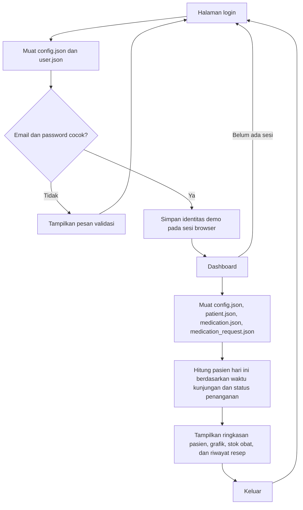

# Admin Web Medical Record

Prototipe web SIMRS untuk membantu staf fasilitas kesehatan meninjau aktivitas layanan harian, pasien terbaru, progres kunjungan, informasi stok obat, dan riwayat resep. Antarmuka mengikuti referensi login dan dashboard dalam `docs/`.

## Fitur Aktif

- Halaman login dua kolom dengan nama fasilitas kesehatan dan informasi bantuan dari `data/json/config.json`.
- Validasi akun demo yang tersimpan pada `data/json/user.json`; dashboard hanya dibuka setelah login pada sesi browser yang sama.
- Dashboard responsif sesuai tata letak referensi: ringkasan jumlah pasien, obat, dan resep berada di atas grafik, progres, serta aktivitas pada kolom kiri; Pasien Terbaru berada di atas Indeks Obat dan Riwayat Resep yang tersusun sejajar pada kolom kanan.
- Kartu ringkasan pasien, obat, dan resep menampilkan jumlah data dari berkas JSON terkait dengan warna pastel, ikon, dan keterangan sesuai desain `docs/group-dashboard.png`.
- Dashboard desktop memenuhi seluruh lebar dan tinggi browser tanpa bingkai atau garis luar.
- Header dan menu navigasi kiri tetap terlihat saat halaman dashboard digulir.
- Peralihan ke mode gelap menggunakan animasi circular reveal dari tombol tema; preferensi pengurangan gerakan tetap dihormati.
- Dashboard menampilkan footer hak cipta dengan jarak dan garis pemisah dari konten utama; kartu Aktivitas Anda tidak lagi memiliki tombol Perbarui.
- Kartu Pasien Minggu Ini, Indeks Obat, dan Riwayat Peresepan menggunakan garis pemisah header/footer yang tegas; daftar obat dan resep dapat digulir dan dicari, serta menampilkan footer jumlah record.
- Pada desktop, kartu Aktivitas Anda mengisi sisa tinggi kolom agar tepi bawahnya sejajar dengan Indeks Obat dan Riwayat Peresepan, dengan baris aktivitas tersebar merata mengisi kartu; pada layar sempit kartu kembali mengikuti isi.
- Kartu Aktivitas Anda menampilkan setiap jenis layanan dengan indikator batang dan jumlahnya, serta total layanan yang dihitung otomatis.
- Grafik kunjungan menggunakan ApexCharts lokal.
- Daftar pasien demo dengan waktu kunjungan, status penanganan, foto opsional, dan placeholder foto.
- Memilih kartu Pasien Terbaru membuka modal detail pasien yang responsif, tanpa garis pinggir, dengan warna latar sesuai kartu yang dipilih dan tombol Lihat Selengkapnya.
- Progres harian dihitung dari pasien pada tanggal berjalan di zona waktu Jakarta; ringkasan menunjukkan jumlah pasien yang sudah dan belum ditangani.
- Grafik kunjungan menampilkan tanggal tujuh hari terakhir tanpa legenda berulang, menyediakan navigasi per periode tujuh hari, dan menandai data hari ini dengan bar oranye.
- Indeks obat dari `data/json/medication.json`, menampilkan seluruh obat dalam daftar scrollable dengan pencarian dan indikator stok berdasarkan jumlah serta batas stok minimum.
- Klik atau keyboard pada item Indeks Obat dan Riwayat Peresepan membuka modal detail berwarna putih tanpa garis pinggir dengan tombol Selengkapnya; detail obat mencakup kategori dan stok, sedangkan resep memuat pasien, dokter, waktu, status, serta obat dan aturan pakai dalam bidang selebar modal.
- Riwayat resep dari `data/json/medication_request.json`, menampilkan nomor resep, pasien, waktu, dan status.
- Unduh grafik dan keluar dari sesi demo.
- Tombol login Google ditampilkan nonaktif sesuai panduan desain.

## Requirements

- PHP 8+ atau server web lokal lain yang menyajikan file proyek melalui HTTP.
- Node.js dan npm untuk memasang pustaka frontend.
- Browser modern dengan JavaScript aktif.

## Persiapan dan Menjalankan

1. Pasang dependensi proyek dengan `npm install`.
2. Jalankan server PHP built-in dari root proyek dengan `php -S localhost:8000`.
3. Buka `http://localhost:8000/login.html`.
4. Untuk masuk ke dashboard gunakan akun demo:
   - Email: `dokter@ghotamcity.id`
   - Password: `Ghotam123!`

Jangan membuka halaman langsung melalui `file://`; browser perlu mengakses berkas JSON menggunakan HTTP. Data pasien dan kredensial pada JSON hanya untuk demonstrasi: autentikasi sisi klien ini bukan mekanisme keamanan dan tidak boleh digunakan untuk menyimpan atau memproses rekam medis sungguhan.

## Dependensi

Pustaka yang digunakan oleh halaman:

- [ApexCharts](https://www.npmjs.com/package/apexcharts) untuk grafik dashboard.
- [Bootstrap Icons](https://www.npmjs.com/package/bootstrap-icons) untuk ikon.
- [SweetAlert2](https://www.npmjs.com/package/sweetalert2) untuk dialog informasi dan detail demo.

Bootstrap dan jQuery juga tercantum pada `package.json`, tetapi halaman prototipe saat ini tidak memerlukannya untuk interaksi maupun tata letak. Semua aset pustaka dimuat dari `node_modules`; tidak ada CDN.

## Alur Aplikasi

